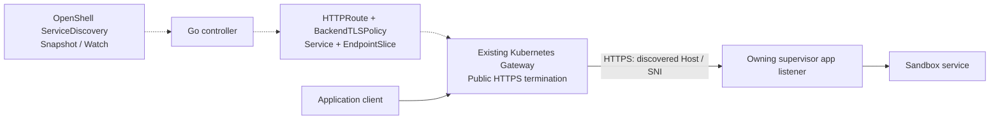

# OpenShell Kubernetes ingress controller

A standalone HTTPRoute controller POC consuming the OpenShell service discovery
API through [`github.com/ai-openshell/sdk-go`](https://github.com/ai-openshell/sdk-go).
It reconciles routes for an existing Kubernetes Gateway; the OpenShell gateway
and compute driver do not manage ingress resources.



Dashed arrows configure routing; solid arrows carry application traffic. The
controller consumes exact hostnames and supervisor IP/port endpoints from
`openshell.v1.ServiceDiscovery.GetServiceRouteSnapshot` and `WatchServiceRoutes`.
It does not reconstruct hashed hostnames or use sandbox-listing APIs. Multiple
services and sandboxes each get an exact-host HTTPRoute. It creates HTTPRoutes,
not TLSRoutes.

## Local setup

Requires Go 1.25.13 or newer. Discovery support is currently unreleased in the Go
SDK. The module records the released baseline `v0.1.7`; building this POC requires
the local SDK checkout with its discovery changes until they are published.
No SDK code is vendored into this repository.

From this checkout, create an ignored local workspace:

```shell
go work init .
go work edit -replace github.com/ai-openshell/sdk-go="$HOME/Projects/ai-openshell/sdk-go"
make check
make build
```

If `go.work` already exists, run only `go work edit` to update the SDK location.
The local SDK must provide `client.ServiceRoutes().Snapshot/Watch` backed by the
separate `ServiceDiscovery` service and its matching generated bindings. The
workspace and developer paths are ignored by Git. Building without that
workspace is deferred until the SDK dependency can be updated to a discovery
release.

Run locally with Kubernetes credentials:

```shell
./bin/controller --config config.example.json --kubeconfig "$HOME/.kube/config"
```

Omit `--kubeconfig` inside a Pod to use its ServiceAccount. Health probes listen
on port 9092: `/healthz` reports liveness; `/readyz` requires successful discovery
and reconciliation on the leader. Standbys remain ready for takeover.

## Configuration

Edit [config.example.json](config.example.json) or the ConfigMap in
[deploy/controller.yaml](deploy/controller.yaml).

| Field | Purpose |
| --- | --- |
| `controllerID` | Stable resource ownership and leader-election identity |
| `namespace` | Namespace for managed routes, backends, policies, and Lease |
| `gateway`, `gatewayNamespace`, `listener` | Existing Kubernetes Gateway attachment target |
| `backendCAConfigMap` | ConfigMap in the managed namespace with supervisor TLS trust under `ca.crt` |
| `sources[].id` | Stable identity for a discovery source |
| `sources[].endpoint` | OpenShell gateway HTTPS discovery endpoint |
| `sources[].workspace` | Explicit workspace for that source |
| `sources[].caFile` | CA trust for discovery API TLS |
| `sources[].certFile`, `sources[].keyFile` | Client certificate and key for discovery authorization |
| `sources[].tokenFile` | Alternative workspace-authorized bearer token file |

Configure each source with an authorized mTLS identity or bearer token. Credentials
reload on reconnect. For discovery-only certificates, configure the corresponding
workspace grant on the OpenShell gateway. Sources use explicit single-workspace
requests; multiple sources can cover different workspaces or gateway installations.
This POC does not request the all-workspaces selector.

Enable the supervisor app listener and configure its application domain/public
URL on OpenShell. Service discovery requires the app listener. Gateway-mediated
application routing can independently be disabled with
`[openshell.gateway].service_routing_enabled = false`; the controller does not
rely on gateway URLs or gateway application forwarding. Application authentication
belongs to the ingress provider/application.

## Deploy

Requires HTTPRoute v1 and BackendTLSPolicy v1 CRDs and a Gateway implementation
supporting both. [deploy/gateway.yaml](deploy/gateway.yaml) is an optional Envoy
Gateway example using HTTPS termination and a wildcard certificate. Align its
hostname with the OpenShell application domain and configure DNS separately.
The controller may instead attach to an independently managed Gateway.

Build a Linux image from the same local Go workspace:

```shell
make image IMAGE=openshell/kube-ingress-controller:poc GOARCH=amd64
```

Use `GOARCH=arm64` for an ARM cluster. Load or push the image using your cluster's
normal workflow and set the Deployment image accordingly.

Before applying, provision these operator-managed resources in the target namespace:

- `openshell-app-ingress-tls`: the Gateway's public wildcard certificate Secret.
- `openshell-supervisor-app-ca`: a ConfigMap with the supervisor app-listener CA
  under `ca.crt`, matching `backendCAConfigMap`.
- `openshell-discovery-identity`: a dedicated discovery identity Secret containing
  `ca.crt`, `tls.crt`, and `tls.key`, matching the example configuration.

Discovery credentials, supervisor CA trust, and public ingress certificates have
different roles. Do not mount the gateway's server private key into the controller.
For bearer authentication, replace the certificate mounts/configuration with the
authorized token file and retain discovery server CA verification.

```shell
kubectl -n openshell apply -f deploy/gateway.yaml
kubectl -n openshell apply -f deploy/controller.yaml
```

The Deployment runs two replicas with a namespaced Lease. RBAC covers only
Services, EndpointSlices, HTTPRoutes, BackendTLSPolicies, and Leases in the managed
namespace. It grants no Secret reads or OpenShell gateway administration. Allow
the Gateway data plane to reach supervisor app-listener ports through NetworkPolicy;
the controller needs discovery API and Kubernetes API access.

For each discovered route, a selectorless ClusterIP Service and EndpointSlice
point to the owning supervisor's advertised IP/port. These are ingress-adapter
resources managed by this controller, not Services created by the compute driver.
BackendTLSPolicy validates supervisor TLS using the exact discovered hostname as
SNI. The Gateway preserves the HTTP Host; there is no hostname rewrite, plaintext
fallback, or headless Service. Public traffic bypasses the OpenShell gateway and
optional sandbox proxy.

## Validation and POC limits

`make check` runs formatting checks, `go vet`, and race-enabled tests. Tests cover
resource creation/repair, backend replacement, withdrawal/expiry, collisions,
foreign-resource protection, buffered updates, and bounded discovery views.
TLS transport tests use the real SDK against a server exposing only the separate
ServiceDiscovery service, then reconcile with a fake Kubernetes API. They exercise
multiple sandbox services, hashed hostnames, renewals, owner replacement, and
permission loss. They do not claim live Gateway traffic validation.

An optional seeded Rust-gateway test runs when
`OPENSHELL_DISCOVERY_VALIDATION_ENDPOINT` is set, with
`OPENSHELL_DISCOVERY_VALIDATION_CA`, `OPENSHELL_DISCOVERY_VALIDATION_TOKEN`, and
`OPENSHELL_DISCOVERY_VALIDATION_WITHDRAW`. Its fixture must serve a hashed
`default/demo/web` route at `10.0.0.7:9443`, renew it, and withdraw it after the
marker file is written. This test is skipped by default.

For a live cluster, verify public HTTP/WebSockets with the sandbox proxy stopped,
HTTPRoute `Accepted`/`ResolvedRefs`, BackendTLSPolicy `Accepted`, and EndpointSlice
addresses matching discovery. Exercise an incorrect backend CA, owner replacement,
controller takeover, and discovery withdrawal separately.

This remains a compatibility POC. It accepts up to eight sources and 64 combined
routes. Ambiguous hostnames are withdrawn; invalid views and authorization loss
clear that source; transient errors retain only unexpired entries. Accepted
leases are locally capped at 15 seconds. These bounds are controller limits,
not sandbox service limits.

Kubernetes routing resources have no TTL: expiry cleanup requires a running
controller, and deleting an HTTPRoute does not guarantee closing established
connections. Supervisor ownership/freshness checks remain independent. Strict
outage expiry, established-stream revocation, and production load qualification
are outside this POC.
